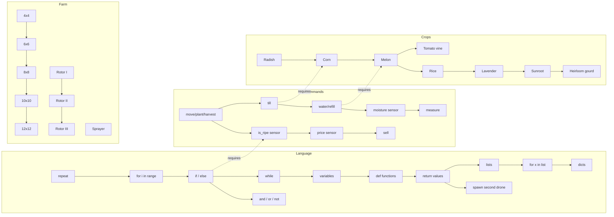

# Campaign & Skill Tree

## Structure

```
Campaign
├── Chapter 1  "First Light"      (sequencing)
├── Chapter 2  "Rows"             (repeat / for loops)
├── Chapter 3  "Ripe or Not"      (conditionals, sensors)
├── Chapter 4  "Until Done"       (while, booleans)
├── Chapter 5  "Ledger"           (variables, arithmetic)
├── Chapter 6  "Your Own Commands"(functions)
├── Chapter 7  "Inventory"        (lists, for-in)
├── Chapter 8  "Market Sense"     (combining sensors, strategy)
├── Chapter 9  "Order Matters"    (sorting, nested loops)
└── Chapter 10 "Second Drone"     (spawn: concurrency basics)
```

Each chapter contains:
- **3–5 contracts.** Objectives with a cycle budget, e.g. *"Harvest 20 radishes within 4,000 cycles"*.
- **One "aha" lesson.** An interactive explanation shown when the chapter's concept unlocks, with an editable example.
- **An optional ★★★ challenge.** The same contract with a tighter budget or a shorter-code target, for wallet credits and a badge.

Contract rewards: wallet credits plus XP. First completion also unlocks the next contract.

## Skill tree

The skill tree is a DAG. Nodes cost **farm credits** and require prerequisite nodes or a completed chapter.



### Node design rules

- **Language nodes are gated by chapter**, not just credits, so the curriculum order is preserved. You can't buy `while` before Chapter 4.
- **Farm, drone and crop nodes are credits-only.** This is the "upgrade your farm" fantasy.
- Every language node unlock opens a **lesson card** with the new syntax and a runnable example that edits the player's current program, not a blank one.
- Before a builtin that "does work for you" unlocks (e.g. `goto(x, y)`), the player first writes it themselves in a contract. Then it unlocks as a cheaper native builtin. *You earn the shortcut by understanding it.*

### Skill tree UI

**Node states.** Each state has an icon and a text label as well as a color, so none relies on color alone ([accessibility](../05-ux/accessibility.md)).

| State | Look | Label |
|---|---|---|
| **Owned** | Filled | (none) |
| **Available** | Glowing, price shown | "₵300" |
| **Unaffordable** | Price in red | "Need ₵120 more" |
| **Needs prerequisite** | Dimmed | "Requires: for i in range" |
| **Chapter-gated** | Padlock | "Unlocks after Chapter 4" |

If several gates apply, show the first unmet one in this order: chapter, prerequisite, price. Prices here are examples. Real node prices live in `content`.

**Buying a node.**

1. Tap any node to open the **side panel**: name, what it unlocks (builtins or syntax, with cycle costs), a 3-line example, and the **[Unlock for ₵300]** button (disabled with the reason if the node is not Available).
2. Confirm inline: "Unlock `while` for ₵300? You'll have ₵140 left." **[Unlock]**.
3. On success the node fills, the farm credits counter ticks down, and the **lesson card** opens (language nodes only).
4. If the server rejects the request (it re-checks prerequisites, chapter and cost; for example the save changed in another tab or device), show "That didn't work: your save changed on another device. Reloading…", then refetch `GET /api/campaign` and redraw the tree.

Farm, drone and crop nodes show their effect in the side panel instead of a lesson, e.g. "Rotor II: move costs 12 cycles (was 16)".

## Saves

- Autosave on every run end, every contract completion, every purchase, and every 30 s while editing.
- Multiple program "files" per save (tabs in the editor), max 10 files of 16 KB each.
- One campaign save slot per account in v1. Three slots are possible later.
- Details: [saves-and-persistence](../03-architecture/saves-and-persistence.md).

## Free Farm (idle layer)

Outside contracts, the player's farm (size from the skill tree) runs their chosen program **while the tab is open**. Sales earn farm credits at the real simulation rate. There are no offline earnings in v1, because that needs a server-side simulation per user and costs real compute. Every Free Farm session submits a **run receipt** (program, seed, start state, cycles run) that the server re-simulates before crediting. See [security-anti-cheat](../03-architecture/security-anti-cheat.md).
