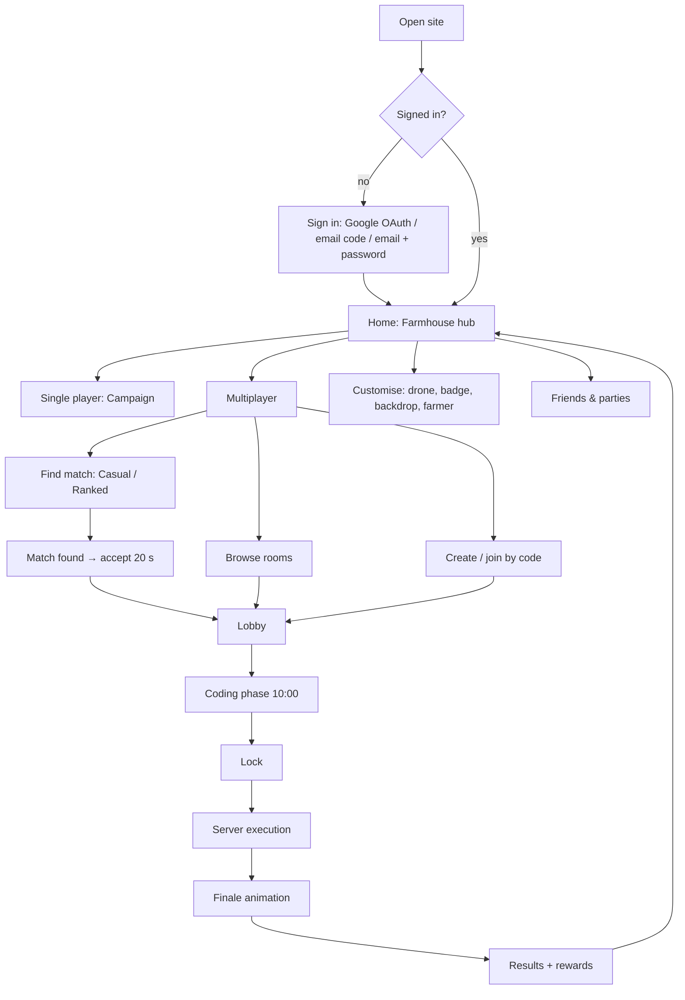

# Core Loop

## Top-level flow



## Single-player loop (campaign)

```
pick contract → read brief → write/edit program → Run (watch drone) → tweak → contract complete
      ↑                                                                    │
      └──── spend credits in skill tree / shop ←── sell harvest for ₵ ←────┘
```

- **Session target:** 5–15 min per contract. You can quit at any point because saves happen automatically.
- **Run controls:** Run, Pause, Step (one statement), Speed (1×, 4×, 16×, Max), Reset farm.
- **Persistent farm:** Between contracts there is a **Free Farm** sandbox. Your farm keeps running your last program while you watch, and you can sell harvests for credits. This is the "idle satisfaction" layer.
- **What the player spends credits on:** skill-tree nodes (language features, commands, crops, farm size, drone speed) and cosmetics.
- **Why learn more:** later contracts can't be finished in the cycle budget with naive code, so each unlock is a real upgrade.

See [campaign-and-skill-tree.md](campaign-and-skill-tree.md).

## Multiplayer loop (showdown)

| Phase | Duration | What happens |
|---|---|---|
| Lobby | until all ready (max 60 s in matchmade) | See rivals' cosmetics, rules card and the farm preview |
| Coding | **10:00** (casual: 5 / 10 / 15 selectable; ranked: 10 fixed) | Everyone codes against the **same seed**. "Test run" simulates privately in your browser on your own farm, with a market model that assumes no rivals. Draft autosaves to the server every 10 s. |
| Lock | instant | Server freezes the last submitted draft. If you have no valid program, you get an idle program. |
| Execution | < 1 s server time | All farms run in lockstep against the shared market for the cycle budget |
| Finale | ~60–90 s | Animated replay: all farms side by side and money towers rising, then the podium |
| Results | until dismissed | Score breakdown, awards, credits/RP earned, "watch replay", "view code" for every player, rematch |

**Total showdown time:** about 13–14 minutes.

"All code is unlocked" in multiplayer, so every language feature and command is available regardless of campaign progress. That is fair because nobody plays with more tools than anyone else. Players who haven't reached a feature in the campaign see a **"New to you"** tag on it in the command reference.

## Why both modes share one engine

The same `packages/lang` and `packages/sim` run:
- in the browser for single-player and multiplayer test runs, so feedback is instant
- on the server for official multiplayer results and single-player credit verification

Because the simulation is deterministic (see [simulation-engine](../03-architecture/simulation-engine.md)), a browser test run and a server run of the same program and seed produce identical results. The only exception is the shared market, which depends on rivals.
