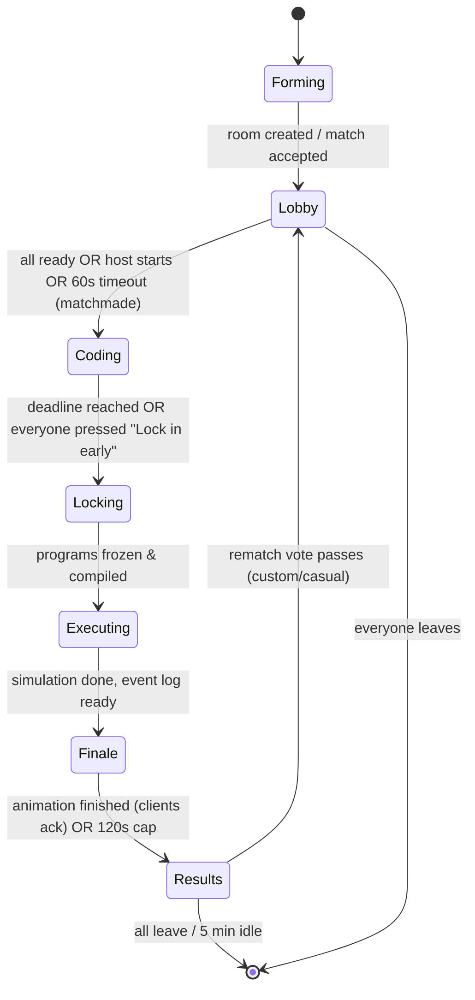

# Multiplayer Modes

## Modes at a glance

| Mode | Entry | Players | Coding time | Rewards | Rules |
|---|---|---|---|---|---|
| **Casual** | Find Match (queue) | 2–8 (fills to 4 target) | 10:00 | Wallet credits by placement, XP | Standard |
| **Ranked** | Find Match (queue) | **4 FFA** (fixed) | 10:00 (fixed) | RP + wallet credits + XP | Standard, locked settings |
| **Custom room** | Create room, then share code, or appear in the room browser | 2–8 | 5 / 10 / 15 | XP only (no credits, to prevent farming) | Host chooses grid, time, modifiers |
| **Practice vs bots** | Single player menu | 1 + 1–7 bots | Any | None | Any |

### Why ranked is 4-player free-for-all
- 1v1 needs a large population to match fairly, and early on queues would be empty.
- 8-player lobbies take too long to fill and make placement RP noisy.
- 4 FFA gives a clear 1st/2nd/3rd/4th, a short queue and a readable finale. *(D-10: add a 1v1 Duel queue once concurrent ranked players exceed ~200.)*

### Bots
Bots are named `[BOT] Scarecrow`, `[BOT] Tractor`, etc. and always shown with the bot tag. Each bot runs a handwritten Sprout program from `packages/content/bots/` at a difficulty: Seedling (naive loop), Grower (conditionals) or Agronomist (market-aware). Bots double as **reference solutions** and as balance-harness players.

Bots never appear in ranked. In casual, if the queue can't find 2 humans in 90 s, the player is offered *"Play now with bots?"*. The match is then labelled casual-with-bots and pays reduced credits.

## Showdown state machine (server-authoritative)

- **Server owns every deadline.** Clients show countdowns computed from `serverDeadline − estimatedClockOffset`.
- **Lock in early:** players can lock early. If all players lock, coding ends immediately. Early lock is shown to rivals as a ✔ next to the name, which is a social signal but leaks no code.
- **Disconnects:** the player's last autosaved draft (10 s cadence) is used. If they reconnect during coding they get a snapshot and continue. If they have no draft, they run the idle program and score 0 (the starting ₵100 does not count, see scoring).
- **Leaving ranked** during lobby or coding counts as a loss (4th place RP) plus a queue cooldown.

## What rivals can see

| When | Visible about rivals |
|---|---|
| Lobby | Name, rank, cosmetics, level, ready state |
| Coding | Name, "typing…" pulse, test-run count, locked-in ✔. **No code, no farm.** |
| Finale | All farms animated side by side, live credit counters |
| Results | Full code of every player, score breakdown, replay |

*(Open question D-05 from the original concept: answered as "only afterward".)* Showing code afterward is the teaching payoff, because you see exactly how the winner did it.

## Room codes & browser
See [rooms-and-lobbies](../03-architecture/rooms-and-lobbies.md).

## Rematch
Casual and custom rooms show a rematch vote. If at least 50 % accept within 20 s, the room returns to Lobby with a **new seed**, and players who declined leave. Ranked has no rematch, because players must requeue.

## Variants (post-MVP rotation, casual and custom only)
- **Sprint:** 5:00 coding, 6×6 grid.
- **Rocky:** seeded rock obstacles.
- **Weather:** crows, rain and market-boom events.
- **Golf:** score = credits ÷ program size (tokens). The shortest good program wins.
- **Relay (2v2):** teammates alternate 2:30 coding blocks on a shared program. This needs a collaborative editor, so it's deferred.
