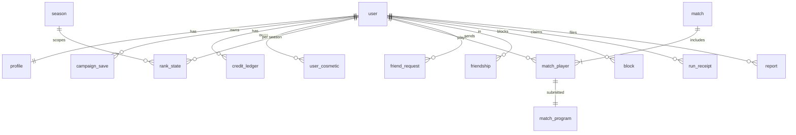

# Data Model (Neon Postgres + Drizzle, `packages/db`)

Conventions: `snake_case`, `uuid` PKs (`gen_random_uuid()`), `created_at timestamptz default now()`. Better Auth owns `user`, `session`, `account`, `verification`, and our tables reference `user.id`.

## Entity overview



## Tables

### Identity & profile
```sql
profile (
  user_id uuid pk references "user"(id) on delete cascade,
  handle citext unique not null,             -- [a-z0-9_]{3,16}
  handle_changed_at timestamptz,
  level int not null default 1,
  xp int not null default 0,
  wallet_credits int not null default 0 check (wallet_credits >= 0),  -- cache of ledger sum
  loadout jsonb not null default '{}',       -- zod: Loadout
  equipped_badges text[] not null default '{}',
  settings jsonb not null default '{}',      -- editor theme, audio, accessibility
  birth_year_confirmed_13plus boolean not null default false,
  role text not null default 'player',       -- 'player' | 'moderator' | 'admin'
  created_at timestamptz not null default now()
)
```

### Campaign
```sql
campaign_save (
  id uuid pk, user_id uuid fk, slot smallint default 0,
  version int not null,                       -- optimistic concurrency
  rules_version text not null,
  farm_credits int not null default 0,
  state jsonb not null,                       -- zod: CampaignState (unlocks, farm size, drone upgrades, contract progress)
  files jsonb not null,                       -- [{name, source}] up to 10 × 16 KB
  updated_at timestamptz not null,
  unique (user_id, slot)
)
contract_attempt (
  id uuid pk, user_id uuid fk, contract_id text, started_at, ended_at,
  succeeded boolean, cycles_used int, program_tokens int, error_codes text[]
)
run_receipt (
  id uuid pk, user_id uuid fk, kind text,      -- 'contract' | 'free_farm'
  contract_id text null, seed bigint, rules_version text, language_version text,
  source_hash bytea, source text, start_state_hash bytea,
  cycles int, claimed_credits int, verified_credits int, status text,  -- 'granted' | 'mismatch' | 'rejected'
  created_at timestamptz
)
```

### Economy (append-only ledger)
```sql
credit_ledger (
  id bigserial pk, user_id uuid fk,
  delta int not null,                          -- + earn, - spend
  reason text not null,                        -- 'match_reward' | 'contract_reward' | 'daily_win' | 'shop_purchase' | 'admin_adjust'
  ref_id uuid null,                            -- match id / receipt id / cosmetic id
  idempotency_key text unique not null,        -- e.g. 'match:<id>:<user>' (no double-grants)
  created_at timestamptz
)
user_cosmetic ( user_id uuid fk, cosmetic_id text, acquired_at, source text, primary key (user_id, cosmetic_id) )
```
`profile.wallet_credits` is updated in the **same transaction** as the ledger insert. A nightly job verifies `sum(ledger) = wallet_credits`.

### Matches
```sql
match (
  id uuid pk, mode text,                        -- 'casual' | 'ranked' | 'custom' | 'practice'
  season_id int null, seed bigint, rules_version text, language_version text,
  settings jsonb, started_at, ended_at, event_log_url text null   -- cached log in object storage (optional)
)
match_player (
  match_id uuid fk, slot smallint, user_id uuid null,   -- null for bots / deleted users
  bot_id text null, placement smallint, score int,
  cycles_last_change int, logic_cycles int, program_tokens int,
  awards text[], credits_awarded int, xp_awarded int,
  rp_before int null, rp_after int null, rank_before smallint null, rank_after smallint null,
  left_early boolean default false,
  primary key (match_id, slot)
)
match_program ( match_id uuid, slot smallint, source text, source_hash bytea, compiled_ok boolean,
                primary key (match_id, slot) )
```

### Ranked
```sql
season ( id serial pk, name text, starts_at, ends_at, rules_version text )
rank_state (
  user_id uuid fk, season_id int fk,
  rank_index smallint not null,                 -- 0..14
  rp int not null, placements_played smallint default 0,
  win_streak smallint default 0, shield_games smallint default 0,
  peak_rank_index smallint, games int, wins int,
  primary key (user_id, season_id)
)
queue_penalty ( user_id uuid, mode text, day date, offences smallint, cooldown_until timestamptz,
                primary key (user_id, mode, day) )
```

### Social & safety
```sql
friendship ( user_a uuid, user_b uuid, created_at, primary key (user_a, user_b), check (user_a < user_b) )
friend_request ( from_user uuid, to_user uuid, created_at, primary key (from_user, to_user) )
block ( blocker uuid, blocked uuid, created_at, primary key (blocker, blocked) )
report ( id uuid pk, reporter uuid, target_user uuid null, match_id uuid null,
         category text, note text check (length(note) <= 500), status text, created_at )
```

## Transactions that must be atomic

| Operation | Tables in one transaction |
|---|---|
| Match finished | `match`, `match_player`×N, `match_program`×N, `credit_ledger`×N, `profile` (credits, xp), `rank_state`×N |
| Shop purchase | `credit_ledger` (−price, idempotency key), `profile.wallet_credits`, `user_cosmetic` |
| Run receipt granted | `run_receipt`, `campaign_save` (version check), `credit_ledger` (wallet part, if a contract reward) |

## Neon specifics
- Use the **pooled** connection string (PgBouncer) from the server. Use the direct string for migrations.
- **Branch per PR** for preview environments (Neon branching), with migrations applied on branch creation.
- Autosuspend is fine for dev and preview. For prod, set a minimum compute or accept a cold-start of under a second on first query after idle.
