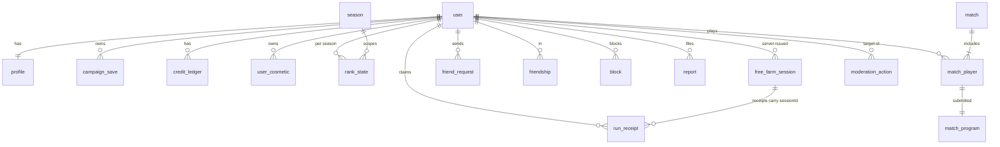

# Data Model (Neon Postgres + Drizzle, `packages/db`)

Conventions: `snake_case`, `uuid` PKs (`gen_random_uuid()`), `created_at timestamptz default now()`. Better Auth owns `user`, `session`, `account`, `verification`, and our tables reference `user.id`.

## Entity overview



## Tables

### Identity & profile
```sql
profile (
  user_id uuid pk references "user"(id) on delete cascade,
  handle citext unique not null,             -- [a-z0-9_]{3,16}
  handle_changed_at timestamptz,
  handle_change_required boolean not null default false,   -- set by a moderator ('force_handle_change'); cleared when the player picks a new handle
  level int not null default 1,
  xp int not null default 0,
  wallet_credits int not null default 0 check (wallet_credits >= 0),  -- cache of ledger sum
  loadout jsonb not null default '{}',       -- zod: Loadout
  equipped_badges text[] not null default '{}',
  settings jsonb not null default '{}',      -- editor theme, audio, accessibility
  birth_year_confirmed_13plus boolean not null default false,  -- the ONLY age data we store; the birth year is never received or stored
  terms_version text,                        -- Terms + Privacy Policy accepted together (versioned); null until onboarding step 2 is done
  terms_accepted_at timestamptz,
  role text not null default 'player',       -- 'player' | 'moderator' | 'admin'
  banned_until timestamptz,                  -- null = not banned; 'infinity' = permanent
  ban_reason text,
  deleted_at timestamptz,                    -- soft delete, see Account deletion
  hard_delete_after timestamptz,             -- deleted_at + 30 days
  created_at timestamptz not null default now()
)
```

- **Age gate.** The 13+ gate runs on the landing screen **before sign-in** (see [auth](auth.md) and [privacy-and-age](../08-legal-safety/privacy-and-age.md)), so an under-13 visitor never creates an account and the server never receives an email, a Google id or a birth year for them. `birth_year_confirmed_13plus` is set to `true` when the profile is created and nothing else about age is persisted. Onboarding after the first sign-in is: handle, then Terms/Privacy acceptance (`terms_version`, `terms_accepted_at`). There is no "abandon account" endpoint.
- **Server-owned columns.** `role`, `wallet_credits`, `level`, `xp`, `birth_year_confirmed_13plus`, `terms_*`, `banned_until`, `ban_reason`, `handle_change_required`, `deleted_at` and `hard_delete_after` are written only by server code paths. Client-facing `PUT` bodies are zod allowlists (`loadout`, `settings`, `equipped_badges`, campaign files) that reject unknown keys, so these columns can never arrive from a client.
- **First admin.** `role` changes only through an owner-run SQL statement over the direct Neon connection (for example `update profile set role = 'admin' where handle = '…'`) or through `POST /api/admin/users/:id/role` by an existing admin, which writes a `moderation_action` row.

### Campaign
```sql
campaign_save (
  id uuid pk, user_id uuid fk, slot smallint default 0,
  version int not null,                       -- optimistic concurrency
  rules_version text not null,
  farm_credits int not null default 0,
  state jsonb not null,                       -- zod: CampaignState (unlocks, farm size, drone upgrades, contract progress)
  files jsonb not null,                       -- [{name, source}] up to 10 × 16 KB
  updated_at timestamptz not null,
  unique (user_id, slot)
)
contract_attempt (
  id uuid pk, user_id uuid fk, contract_id text, started_at, ended_at,
  succeeded boolean, cycles_used int, program_tokens int, error_codes text[]
)
run_receipt (
  id uuid pk, user_id uuid fk, kind text,      -- 'contract' | 'free_farm'
  contract_id text null, session_id uuid null references free_farm_session(id),  -- required for 'free_farm'
  seed bigint check (seed between 0 and 4294967295), rules_version text, language_version text,
  source_hash bytea, source text, start_state_hash bytea,
  cycles int, claimed_credits int, verified_credits int, status text,  -- 'granted' | 'mismatch' | 'rejected'
  created_at timestamptz
)
free_farm_session (                              -- issued by POST /api/campaign/free-farm/start → { sessionId, seed, startedAt }
  id uuid pk, user_id uuid fk not null,
  seed bigint not null check (seed between 0 and 4294967295),
  started_at timestamptz not null default now(),
  ended_at timestamptz null                      -- set when the session is closed or superseded by a newer one
  -- partial unique index on (user_id) where ended_at is null: one active session per user
)
```
Free Farm receipts are checked against the session row: the speed cap is `cycles ≤ (now − started_at) × 1,600 + 5 % slack` (16× speed, 100 cycles per second; see [saves-and-persistence](saves-and-persistence.md)). Seeds are unsigned 32-bit integers (see [simulation-engine](simulation-engine.md#determinism)); Postgres has no unsigned `int4`, so the column is `bigint` with a range check, declared in Drizzle as `bigint('seed', { mode: 'number' })` so it round-trips as a JS `number` matching `SimConfig.seed` (node-postgres otherwise returns `int8` as a string).

### Economy (append-only ledger)
```sql
credit_ledger (
  id bigserial pk, user_id uuid fk,
  delta int not null,                          -- + earn, - spend
  reason text not null,                        -- 'match_reward' | 'contract_reward' | 'daily_win' | 'shop_purchase' | 'admin_adjust'
  ref_id uuid null,                            -- match id / receipt id / cosmetic id
  idempotency_key text unique not null,        -- no double-grants; formats below
  created_at timestamptz
)
user_cosmetic ( user_id uuid fk, cosmetic_id text, acquired_at, source text, primary key (user_id, cosmetic_id) )
ledger_drift ( user_id uuid, expected int, actual int, detected_at timestamptz )   -- written by the reconciliation job
economy_daily ( day date pk, minted bigint, spent bigint )                          -- daily aggregate, survives account deletion
```

**Wallet invariants.** Every wallet change is `INSERT INTO credit_ledger … ON CONFLICT (idempotency_key) DO NOTHING` followed, in the same transaction, by `UPDATE profile SET wallet_credits = wallet_credits + $delta WHERE user_id = $1 AND wallet_credits + $delta >= 0 RETURNING wallet_credits`. Zero rows updated: roll back and return `409 INSUFFICIENT_CREDITS`. Zero rows inserted (duplicate key): roll back and return the original result (idempotent replay). The `UPDATE` row lock serialises concurrent spends; a `SELECT` of the balance is never used to decide anything.

**Idempotency keys:** `match:<matchId>:<userId>` (match reward), `daily-win:<userId>:<utcDate>`, `contract:<contractId>:<userId>` (first-completion bonus), `shop:<purchaseId>` and `admin:<actionId>`. `purchaseId` is a client-generated UUID sent as the `Idempotency-Key` header of `POST /api/shop/purchase`. Owning the item already returns `409 ALREADY_OWNED` and writes nothing (no ledger row, no `user_cosmetic` row). Cosmetics granted without a price (season rewards, campaign badges) are inserted into `user_cosmetic` with `ON CONFLICT DO NOTHING` and a non-shop `source`, and touch no ledger row.

**Farm credits** live only in `campaign_save.farm_credits` and change only through receipt grants and `POST /api/campaign/unlock`. Each of those increments `version`, so a concurrent `PUT /api/campaign` with a stale `If-Match` gets `409`.

**Reconciliation job (nightly, DB-06):** per user, inside one `REPEATABLE READ` transaction, compare `sum(delta)` with `wallet_credits`. On mismatch: write a `ledger_drift` row, set `wallet_credits = sum(delta)` (the ledger is the source of truth; if the sum is negative the job only alerts), and raise the `ledger_reconciliation_failure` alert ([observability](../06-infrastructure/observability.md)). It also asserts that every `user_cosmetic` row with `source = 'shop'` has a matching `shop:` ledger row, and writes the previous day's totals to `economy_daily`.

### Matches
```sql
match (
  id uuid pk, mode text,                        -- 'casual' | 'ranked' | 'custom' | 'practice'
  season_id int null, seed bigint check (seed between 0 and 4294967295),   -- uint32; same Drizzle mode as run_receipt.seed
  rules_version text, language_version text,
  settings jsonb, started_at, ended_at, event_log_url text null   -- cached log in object storage (optional)
)
match_player (
  match_id uuid fk, slot smallint, user_id uuid null,   -- null for bots / deleted users
  bot_id text null, placement smallint, score int,
  cycles_last_change int, logic_cycles int, program_tokens int,
  crops_harvested int,
  awards text[], credits_awarded int, xp_awarded int,
  rp_before int null, rp_after int null, rank_before smallint null, rank_after smallint null,
  left_early boolean default false,
  primary key (match_id, slot)
)
match_program ( match_id uuid, slot smallint, source text, source_hash bytea, compiled_ok boolean,
                primary key (match_id, slot) )
```
`seed` is generated by the server at coding start (an unsigned 32-bit integer, see [simulation-engine](simulation-engine.md#determinism)) and is the same for every player in the match.

### Ranked
```sql
season ( id serial pk, name text, starts_at, ends_at, rules_version text )
rank_state (
  user_id uuid fk, season_id int fk,
  rank_index smallint not null,                 -- 0..14
  rp int not null, placements_played smallint default 0,
  win_streak smallint default 0, shield_games smallint default 0,
  peak_rank_index smallint, games int, wins int,
  primary key (user_id, season_id)
)
queue_penalty ( user_id uuid, mode text, day date, offences smallint, cooldown_until timestamptz,
                primary key (user_id, mode, day) )
```

### Social & safety
```sql
friendship ( user_a uuid, user_b uuid, created_at, primary key (user_a, user_b), check (user_a < user_b) )
friend_request ( from_user uuid, to_user uuid, created_at, primary key (from_user, to_user) )
block ( blocker uuid, blocked uuid, created_at, primary key (blocker, blocked) )
report ( id uuid pk, reporter uuid, target_user uuid null, match_id uuid null,
         category text, note text check (length(note) <= 500), status text, created_at )
moderation_action (                              -- every moderator/admin action, append-only; the admin page is read-only on this table
  id uuid pk, actor_user_id uuid fk, target_user_id uuid null fk, report_id uuid null fk,
  action text not null,     -- 'warn' | 'force_handle_change' | 'temp_ban' | 'perm_ban' | 'unban' | 'credit_adjust' | 'role_change'
  params jsonb not null,    -- e.g. { until, reason, delta }
  note text check (length(note) <= 1000), created_at timestamptz not null default now()
)
```
Bans are state on `profile` (`banned_until`, `ban_reason`; a permanent ban sets `banned_until = 'infinity'`), enforced at socket `hello`, at `queue.join` / `room.join`, and by deleting the user's sessions when the ban is applied (see [auth](auth.md)). A temp ban expires by comparing `banned_until` to `now()`, so no job is needed.

## Transactions that must be atomic

| Operation | Tables in one transaction |
|---|---|
| Match finished | `match`, `match_player`×N, `match_program`×N, `credit_ledger`×N, `profile` (credits, xp), `rank_state`×N |
| Shop purchase | `credit_ledger` (−price, idempotency key), `profile.wallet_credits` (guarded `UPDATE`, see Wallet invariants), `user_cosmetic` |
| Run receipt granted | `run_receipt`, `campaign_save` (version check, and `version` is incremented by the grant), `credit_ledger` (wallet part, if a contract reward) |
| Account hard delete (per user) | every table in the Account deletion table below |

## Account deletion (DB-06 job, runs nightly)

Columns: `profile.deleted_at` and `profile.hard_delete_after` (`= deleted_at + 30 days`). New table `reserved_handle ( handle citext pk, released_at timestamptz )`.

**Soft delete (immediate, one transaction):** set `deleted_at` and `hard_delete_after`, delete all `session` rows (signs out everywhere and closes the user's WebSocket), delete `verification` rows, remove the user from live rooms, queues and parties, delete `friend_request` rows in both directions, and hide the profile and presence (every profile, friends and leaderboard read filters on `deleted_at is null`). Everything else is kept. Signing in again within the 30 days offers "Cancel deletion?", which clears both columns. Data export stays available during the grace period.

**Hard delete (job, once `hard_delete_after` has passed):**

| Table | Action |
|---|---|
| `user`, `account`, `session`, `verification` (Better Auth) | delete (`account` holds the Google id) |
| `profile` | delete; insert `reserved_handle(handle, released_at = now() + 90 days)`. A handle in `reserved_handle` cannot be registered until released, so nobody can impersonate a deleted player |
| `campaign_save`, `contract_attempt`, `run_receipt`, `free_farm_session` | delete (the receipt `source` goes with them) |
| `credit_ledger`, `user_cosmetic`, `rank_state`, `queue_penalty` | delete. The reconciliation job and the economy metrics read the `economy_daily` snapshot written before deletion, so totals do not drift |
| `friendship`, `block` | delete, both directions |
| `match_player` | `user_id = null`; keep `slot`, `placement`, `score` and the stats (rivals' history and replays need them). The UI shows "deleted player" |
| `match_program` | keep `source` (replays must reproduce it) but blank the text of `#` comments, using the Sprout lexer and keeping line breaks so line numbers and bytecode are unchanged. `source_hash` stays as computed at lock |
| `report` | `reporter = null`; rows that target the user get `target_user = null` and are purged 12 months after resolution (provisional; retention periods live in [privacy-and-age](../08-legal-safety/privacy-and-age.md)) |
| `moderation_action` | keep, with `target_user_id = null` |
| Sentry events, pino logs, Resend logs | not deleted one by one; they expire by retention (see the privacy doc) |

The job also appends the opaque user id and the deletion time to the deletion log in the backup bucket, so a restore can re-apply deletions (see [hosting](../06-infrastructure/hosting.md) Backups & restore). Whether to keep a peppered hash of the email of permanently banned accounts to stop ban evasion is an open privacy decision and is **not** part of v1. The one-sentence-per-row version of this table is mirrored in [privacy-and-age](../08-legal-safety/privacy-and-age.md) under User rights.

## Neon specifics
- Use the **pooled** connection string (PgBouncer) from the server (`DATABASE_URL`). Use the direct, non-PgBouncer string (`DATABASE_URL_UNPOOLED`) for migrations, seeds and CI branch setup. Where each variable is stored is listed in [connections](../06-infrastructure/connections.md).
- **Driver.** The server is a long-lived Node process, so use plain TCP, not the HTTP/WebSocket serverless driver: `drizzle-orm/postgres-js` with `postgres(process.env.DATABASE_URL, { prepare: false, max: 10, idle_timeout: 20 })`. Neon's pooled endpoint is PgBouncer in transaction mode, where named prepared statements are not guaranteed to survive across pooled connections, and postgres.js prepares by default. `prepare: false` keeps us independent of the pooler's handling and is cheap insurance at our query volume. `idle_timeout` of about 20 s lets Neon autosuspend in dev and preview instead of idle sockets holding compute awake. An alternative with identical semantics is `drizzle-orm/node-postgres` with a `pg.Pool`. Better Auth's Drizzle adapter receives this same `db` instance.
- **Migrations and seeds** (`drizzle-kit migrate`, CI branch setup) use a second client built from `DATABASE_URL_UNPOOLED`, never the pooled URL.
- **Branch per PR** for preview environments (Neon branching), with migrations applied on branch creation.
- Autosuspend is fine for dev and preview. For prod, set a minimum compute or accept a cold-start of under a second on first query after idle.
