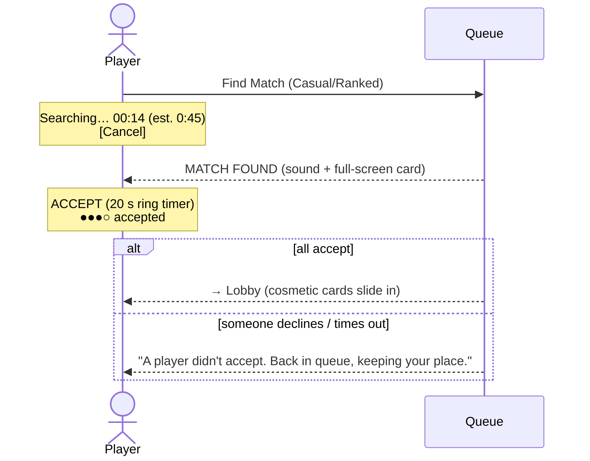

# Matchmaking

Goal: **CS-style "Find Match"**. One button, a visible timer, a "MATCH FOUND" moment with an accept window, and a quick requeue if someone declines.

## Player-facing flow



UX details:
- The search timer and estimated wait show in a persistent **queue pill** at the top of every screen, so players can browse the shop or edit cosmetics while searching.
- When a match is found: an audio sting, a browser tab title flash (`⚑ MATCH FOUND`), and a Notification API ping if permitted and the tab is hidden.
- The accept window is **20 s** (the concept said 30 s; 20 s keeps momentum, see D-08). Pips show how many have accepted, without names.

## Queue data structures (in-memory v1)

```ts
type Ticket = {
  ticketId: string;
  userIds: string[];          // 1 (solo) or a party (casual only)
  mode: 'casual' | 'ranked';
  rankIndex: number;          // 0..14 (Iron III .. Diamond I); casual uses account level band
  enqueuedAt: number;         // original time, preserved on requeue
  region: 'na' | 'eu';        // v1: single region, field reserved
};
```

## Matching algorithm

The matcher runs every **1 s** per mode.

### Ranked (4 FFA, no hidden MMR)
1. Sort tickets by `enqueuedAt` (oldest first).
2. For the oldest ticket `A`, compute its **search window** from wait time:

   | Waited | Allowed rank spread (tiers) |
   |---|---|
   | 0–30 s | ±1 |
   | 30–60 s | ±2 |
   | 60–120 s | ±3 (one full division) |
   | 120–240 s | ±5 |
   | 240 s+ | ±8 |

3. Collect candidates whose own window also includes `A` (mutual acceptance). Take the 3 oldest.
4. If 4 players are found, create a **ready check**. Otherwise move on to the next oldest.
5. Diamond players never match below Gold III, regardless of wait. In that case they see "Low population at your rank: expect longer waits."

### Casual (target 4, allow 2–8)
- Same widening, keyed on **account level band** (1–9, 10–29, 30–59, 60+), and parties count as their size.
- Prefer filling to 4. After 45 s, accept 3. After 75 s, accept 2. After 90 s alone, offer **"Play with bots now?"** (see multiplayer-modes).
- A party is never split.

## Ready check

```
create ReadyCheck { id, tickets, acceptBy = now + 20s }
remove tickets from queue (held)
on accept: mark; if all accepted → create Room (matchmade) → send room.state
on decline or timeout:
  - decliners / non-responders: drop from queue, apply cooldown
  - accepters: re-insert with ORIGINAL enqueuedAt (keeps priority), notify ready.failed{requeued:true}
```

### Decline / no-show cooldowns (per mode, reset daily)

| Offence today | Casual | Ranked |
|---|---|---|
| 1st | none | 1 min |
| 2nd | 1 min | 5 min |
| 3rd | 5 min | 15 min |
| 4th+ | 15 min | 60 min |

Leaving a ranked match after accepting counts as an offence **and** a 4th-place result.

## Edge cases

| Case | Behaviour |
|---|---|
| Player disconnects while queued | Ticket kept 30 s, then removed |
| Player disconnects during ready check | Treated as no response at timeout |
| Player joins a custom room while queued | Auto-leave queue (one activity at a time) |
| Party member goes offline | Party ticket cancelled, party notified |
| Server restart | Queues lost. Clients get `queue.status` absent after reconnect and show "Search was interrupted", with one-click requeue. Acceptable for v1 |

## Metrics to watch

Median and p90 wait per mode and rank, ready-check success rate, rank spread per match, decline rate. These drive the window table and D-10 (adding Duel).

## Scale-out (later)

Move tickets into a Redis sorted set (`zadd queue:<mode> enqueuedAt`) with one matcher leader elected via a Redis lock. The algorithm stays the same.
