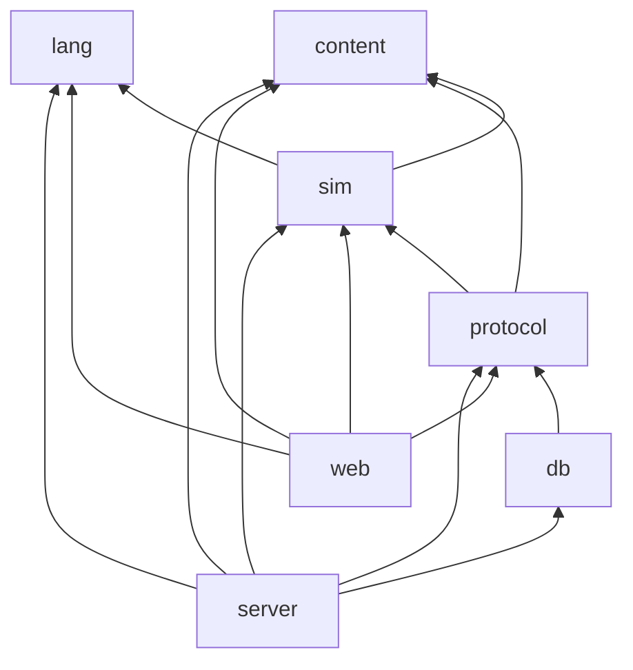

# Monorepo Layout

```
.
├── apps/
│   ├── web/                 Vite + React client
│   │   ├── src/
│   │   │   ├── app/         routes, layout, providers
│   │   │   ├── features/    auth/, home/, campaign/, editor/, showdown/, lobby/,
│   │   │   │                matchmaking/, rooms/, friends/, shop/, profile/, settings/
│   │   │   ├── render/      R3F scene: Farm, Tile, Crop, Drone, Silo, Backdrop, Finale
│   │   │   ├── workers/     sim.worker.ts (lang + sim off main thread)
│   │   │   ├── net/         ws client, reconnect, clock sync, REST client
│   │   │   ├── audio/       sfx registry, music director
│   │   │   └── ui/          design-system components
│   │   └── public/engines/  committed bundles of previous engine majors for replays
│   │                        (see environments-and-ci.md Release process)
│   └── server/
│       └── src/
│           ├── http/        Fastify app, REST routes, Better Auth mount
│           ├── ws/          connection mgr, auth tickets, message router
│           ├── rooms/       Room, phase machine, timers
│           ├── matchmaking/ queues, ready checks, party handling
│           ├── social/      presence, friends, invites
│           ├── execution/   official lockstep runs in a worker_thread pool (2 s kill switch, M3)
│           ├── rewards/     placement → credits/XP/RP, ledger writes
│           └── jobs/        season rollover, cleanup
├── packages/
│   ├── lang/        Sprout lexer, parser, checker, compiler, VM, diagnostics
│   ├── sim/         world state, actions, market, scheduler, event log, PRNG
│   ├── protocol/    zod schemas for WS + REST payloads, shared types
│   ├── content/     crops, stdlib metadata (costs, unlocks), skill tree, contracts,
│   │                cosmetics catalogue, bot programs (Sprout source strings)
│   └── db/          Drizzle schema, `migrations/`, `drizzle.config`, seed scripts (`seed`, `seed:e2e`)
├── assets/          source art/audio + MANIFEST.csv (licenses)
├── tools/           voxel bake, asset manifest check, balance harness CLI,
│                    branch-slug helper shared by preview-db.yml and the preview start script
├── docker-compose.yml   local Postgres for development
├── render.yaml      Render Blueprint
├── .env.example     every environment variable the apps read, documented
└── docs/
```

## Dependency rules (enforced by lint)



(Arrows point from a package to what it depends on.)

- `lang` and `content` depend on **nothing**. `lang` knows nothing about farming. Builtins (and their cycle costs) are *injected* by `sim` through a host-function table, and the campaign's "locked features" set is passed into the compiler as an option.
- `lang` has no DOM, no Node APIs, no `Date`, no `Math.random`. It is verified by an ESLint `no-restricted-globals` rule and a test that runs it in a bare V8 isolate.
- `sim` depends only on `lang` and `content`, with the same purity rules.
- `web` must never import `db`.
- `content` is pure data plus types. Values are tuned here, never hard-coded in `sim`.

## Package conventions

- Every package has `src/index.ts` as its only public entry. Deep imports are forbidden.
- Every package has `vitest` tests next to the source (`*.test.ts`).
- `lang` and `sim` have **golden tests** under `__golden__/`: `{program.sprout, seed, expected.hash}`. `lang` goldens: `expected.hash` = FNV-1a over `str()` of every global plus the print output; `sim` goldens: `expected.hash` = `finalStateHash` and the event count (see [simulation-engine](simulation-engine.md) State hash). CI runs them in Node *and* in Chromium, Firefox and WebKit via Playwright to prove cross-engine determinism.
