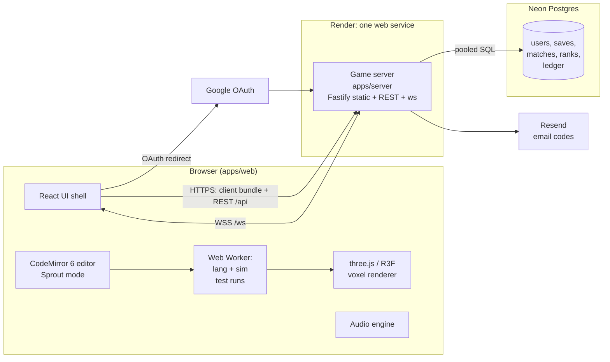
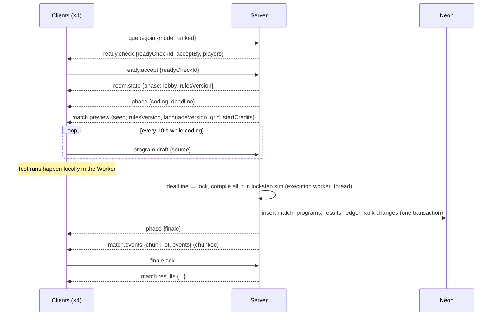

# System Overview

## Components



The diagram shows hosting **Option A**: one Render web service serves the client bundle, REST and WebSockets from one origin. A separate static site on the CDN is hosting Option B, used later (see [hosting](../06-infrastructure/hosting.md)).

## Responsibilities

| Component | Owns | Never does |
|---|---|---|
| **apps/web** | Rendering, editor, local test runs, UI state, audio | Decides official scores, grants credits, trusts its own clock for deadlines |
| **Web Worker** | Runs `lang` + `sim` off the main thread so the UI never freezes, even on `while True:` | Touches the DOM |
| **apps/server** | Auth, sessions, REST API, WebSocket rooms, matchmaking, official simulation, rewards, persistence | Renders anything; runs player code as JS |
| **packages/lang** | Sprout → AST → bytecode → VM | I/O of any kind |
| **packages/sim** | Farm world, actions, market, event log, determinism | I/O of any kind |
| **Neon** | Durable state | Real-time room state (that's in server memory) |

## Single process to start

v1 runs **one game-server process** on one Render instance. Rooms, queues and presence live in memory. That's enough for roughly a few thousand concurrent connections, because the workload is light: messages are infrequent (no 60 Hz state sync), and a full 8-player execution takes on the order of 10–100 ms of CPU.

**Scale-out path** (only when needed; see [hosting](../06-infrastructure/hosting.md)):
1. Move queue, presence and room directory to **Redis** (Render Key Value).
2. Run N server instances. A room is pinned to the instance that created it, and the room directory in Redis maps `roomId → instance`.
3. Grow the execution worker pool (`worker_threads`). From M3 official executions already run in a `worker_thread` with a 2 s kill switch (see [security](security-anti-cheat.md), SRV-06). Scale from one worker to N if executions queue up.

## Request types

| Kind | Transport | Examples |
|---|---|---|
| Account & content | REST (`/api/*`) | profile, saves, shop, friends list, match history, replays |
| Auth | REST (`/api/auth/*`, handled by Better Auth) | sign-in, OAuth callback, email OTP |
| Real-time | WebSocket (`/ws`) | queue, ready check, rooms, coding-phase timers, presence, invites |

## Core data flow: a showdown



## Core data flow: single-player credit claim

```mermaid
sequenceDiagram
  participant W as Browser Worker
  participant S as Server
  participant DB as Neon
  opt Free Farm only
    W->>S: POST /api/campaign/free-farm/start
    S-->>W: {sessionId, seed, startedAt} (one active session per user)
  end
  W->>W: run program on the contract or session seed (local, instant feedback)
  W->>S: POST /api/campaign/runs {contractId | 'free_farm', sessionId?, source, seed, startStateHash, cycles, claimedResult}
  S->>S: recompile + re-simulate (same packages)
  alt results match
    S->>DB: ledger += credits, save progress
    S-->>W: 200 {granted}
  else mismatch
    S-->>W: 409 {serverResult}  (client shows server result; logs anomaly)
  end
```
