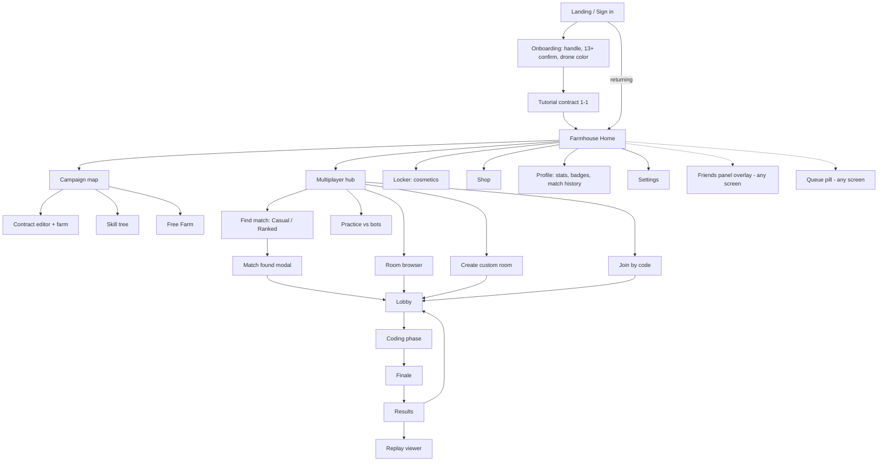

# Screen Flow

## Navigation map



## Key screens

### Home: Farmhouse hub
A 3D diorama of the player's farmhouse, their equipped drone hovering, and the backdrop cosmetic. Large cards: **Campaign** (shows current chapter), **Multiplayer** (shows rank emblem), **Locker**, **Shop**. A top bar holds wallet credits, level, the friends button and settings. The daily first-win bonus indicator is also here.

### Campaign map
Chapters as fields on a hillside path. Each contract is a fence-post marker with ★ ratings. The skill-tree button shows available farm credits.

### Contract / Free Farm editor (the core screen)

```
┌──────────────────────────────────────────────────────────────────────┐
│ Ch3-2 "Only the Ripe Ones"   Goal: 20 radishes ≤ 6,000 cyc   ₵ 340   │
├───────────────────────────────┬──────────────────────────────────────┤
│  main.sprout | helpers.sprout │                                      │
│ 1  def tend():                │          3D FARM VIEW                │
│ 2      if is_ripe():   ×48 ·96│     (drone, crops, moisture)         │
│ 3          harvest()          │                                      │
│ 4  ...                        │  ⏵ Run  ⏸  ⏭ Step  ⟲ Reset  1× 4× 16×│
│                               │  cycles 2,340 / 6,000 ███░░░          │
├───────────────────────────────┼──────────────────────────────────────┤
│ Problems (1) │ Output │ Run log│ Commands ▸ (reference, searchable)   │
└───────────────────────────────┴──────────────────────────────────────┘
```

On tablet, the layout stacks: farm on top, editor below, and a **Blocks / Text** toggle.

### Multiplayer coding phase
Same layout plus: a big countdown in the top center, rival chips (avatar, "typing…" pulse, ✔ locked), a **Lock in** button, a **Test run** button (local), and the banner *"Test runs assume no rivals; prices will move in the real match."*

### Results
See [scoring-and-judging](../01-game-design/scoring-and-judging.md).

## Empty, error and edge states (must be designed, not afterthoughts)

- Queue taking long, with a suggestion to try casual or bots
- Disconnected banner with an auto-reconnect countdown and "your code is saved locally"
- Server-maintenance banner (graceful drain message)
- Rate-limited email code ("check spam, or try again in 2 min")
- Program has an error at lock: the results show "Your program didn't compile: line 7: …"
