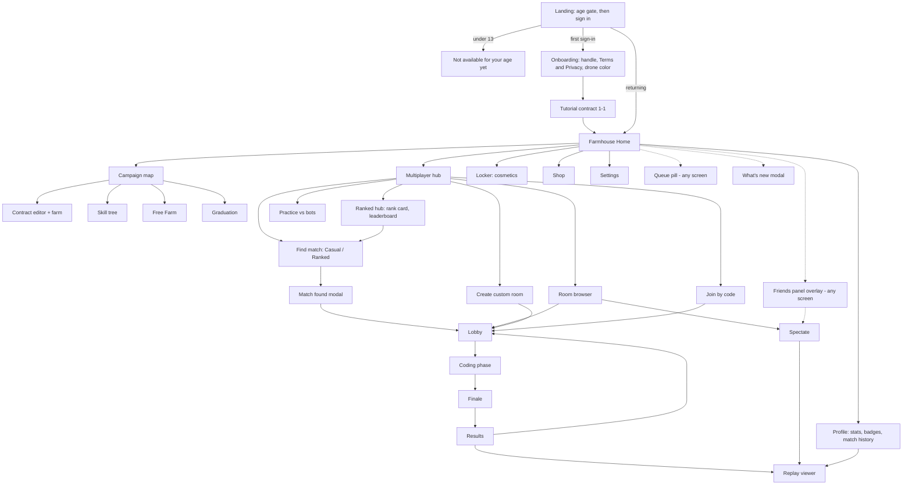

# Screen Flow

## Navigation map



## Key screens

### Landing: age gate, then sign in
Every signed-out visitor sees the **age gate before any sign-in button, email field or Google redirect**. A valid session skips Landing and goes to Home.

- The gate asks **"When were you born?"** with a month and year picker that has no default and gives no hint of the cut-off. The threshold rule is owned by [privacy-and-age](../08-legal-safety/privacy-and-age.md).
- **Under 13:** the screen reads *"Code Harvest isn't available for your age yet."* with no sign-in options, and the browser keeps a 24 h flag so a reload doesn't simply ask again. No account, email or Google id is ever received from this visitor.
- **13 or older:** the sign-in options appear (see [auth](../03-architecture/auth.md)). On first sign-in the browser's age-pass flag travels with the handle claim, and the server stores only the boolean `birth_year_confirmed_13plus`. The month and year are never sent or stored, and there is no later age step and no "abandon account" endpoint.
- Share links (`/r/CODE`) pass through the gate, sign-in and onboarding first (see [rooms-and-lobbies](../03-architecture/rooms-and-lobbies.md)).

### Onboarding (first sign-in only)
1. **Handle.** 3–16 characters (see [social](../03-architecture/social.md)). Taken or rejected handles show an inline message.
2. **Terms and Privacy Policy acceptance**, versioned: the accepted version is stored with the account.
3. **Starter drone color**, then the tutorial contract 1-1.

### Home: Farmhouse hub
A 3D diorama of the player's farmhouse, their equipped drone hovering, and the backdrop cosmetic. Large cards: **Campaign** (shows current chapter), **Multiplayer** (shows rank emblem), **Locker**, **Shop**. A top bar holds wallet credits, level, the friends button and settings. The daily first-win bonus indicator is also here.

### Campaign map
Chapters as fields on a hillside path. Each contract is a fence-post marker with ★ ratings. Each chapter header lists its unlocked lesson cards for re-reading. The skill-tree button shows available farm credits. The tree screen shows node states (Owned, Available, Unaffordable, Needs prerequisite, Chapter-gated), a side panel with an inline unlock confirm, and the lesson card on language-node unlock (see [campaign-and-skill-tree](../01-game-design/campaign-and-skill-tree.md#skill-tree-ui)). After the last Chapter 10 contract is cleared, the map also shows a **Graduation** card.

### Contract editor (the core screen)

```
┌──────────────────────────────────────────────────────────────────────┐
│ Ch3-2 "Only the Ripe Ones"   Goal: 20 radishes ≤ 6,000 cyc   ₵ 340   │
├───────────────────────────────┬──────────────────────────────────────┤
│  main.sprout | helpers.sprout │                                      │
│ 1  def tend():                │          3D FARM VIEW                │
│ 2      if is_ripe():   ×48 ·96│     (drone, crops, moisture)         │
│ 3          harvest()          │                                      │
│ 4  ...                        │  ⏵ Run  ⏸  ⏭ Step  ⟲ Reset  1× 4× 16×│
│                               │  cycles 2,340 / 6,000 ███░░░          │
├───────────────────────────────┼──────────────────────────────────────┤
│ Problems (1) │ Output │ Run log│ Commands ▸ Reference | Lessons      │
└───────────────────────────────┴──────────────────────────────────────┘
```

- Contracts that have an optional ★★★ challenge show a header toggle **Standard | ★★★ Challenge**. The challenge shows its tighter target next to the goal (for example "≤ 4,000 cycles" or "≤ 40 tokens"). The ★ earned per contract appears on the campaign map marker.
- The bottom-right panel has two tabs: **Reference** (searchable) and **Lessons** (every unlocked lesson card, see [curriculum](../02-language/curriculum.md)). Lesson cards open as a modal over this screen.
- Layouts for tablet and phone are in [Responsive rules](#responsive-rules).

### Free Farm
The same editor layout as a contract, with a different header and no goal.

- **Header:** "Free Farm · 8×8 · Farm credits ₵1,240 · Running: main.sprout". There is no goal and no cycle budget, and the cycle counter runs continuously. Farm credits in the header move only when the server grants a receipt.
- **Starting.** Opening Free Farm calls `POST /api/campaign/free-farm/start` and begins a fresh session on the returned seed. Crops don't carry over between sessions. Credits do.
- **Speed:** 1×, 4× and 16× only. `Max` exists only in contracts and showdown test runs (see [saves-and-persistence](../03-architecture/saves-and-persistence.md)).
- **Program picker:** chooses which of your files runs. A session runs one program, so picking another file or editing the running one shows **[Restart farm with this program]**, which ends the session and starts a new one.
- **Sell all** sells the whole silo at the chapter's prices. It is disabled when the silo is empty. Each press is recorded with the cycle it happened at and sent in the receipt.
- **Receipt status pill.** Every 60 s: "Verifying…" then "+₵312 credited". The mismatch, rejection and rate-cap messages are the ones in the outcomes table of [saves-and-persistence](../03-architecture/saves-and-persistence.md). Up to one receipt interval of unsent farming is lost if the tab closes.
- **Another tab.** If Free Farm starts in a second tab, the first shows "Free Farm is running in another tab" with **[Use this tab]**, which starts a new session here.
- **Tab hidden.** The farm keeps running. Browsers may slow a background tab, and the farm never catches up the lost time, so a hidden tab can only fall short of the wall-clock cycle cap, never exceed it.
- **No offline earnings (D-19).** Closing the tab ends the session, and nothing accrues while the game is closed.
- **Reset farm:** "Clear all crops and start over? Credits are kept." It ends the session and starts a new one.

### Responsive rules
Layout class is chosen by viewport width. Touch input only changes the Blocks default (see [editor-ux](editor-ux.md)).

| Class | Width | Gets |
|---|---|---|
| Desktop | ≥ 1024 px | Everything, with the editor beside the farm. |
| Tablet | 768–1023 px | Stacked editor: farm on top (about 40 %), editor below, and a **Blocks / Text** toggle. Multiplayer coding keeps the countdown in the farm header, shows rival chips as a horizontal strip above the editor, and pins **Lock in** as a sticky bottom button. |
| Phone | < 768 px | Home, Campaign in **Blocks mode only**, Free Farm (watch and Sell all), Profile, Shop, Locker, Friends, Spectate, Replay, Ranked hub and leaderboard, Settings. Find Match, Create room, Join by code and Practice are disabled, and the Multiplayer cards read **"Showdowns need a tablet or laptop"**. The room browser stays available for **Watch**. |

Phones stay in Blocks mode (decision D-21). Every construct the curriculum teaches has a block, and Text → Blocks only fails for programs that use more than the curriculum does.

### Multiplayer coding phase
Same layout plus: a big countdown in the top center, rival chips (avatar, "typing…" pulse, test-run count, ✔ locked), a **Lock in** button, a **Test run** button (local), and the banner *"Test runs assume no rivals; prices will move in the real match."* Lock in has no keyboard shortcut because it is irreversible (see [editor-ux](editor-ux.md)).

- **Lock in** opens a dialog: *"Lock in your program? You can't edit it after this. Rivals will see a ✔ next to your name."* **[Keep coding] [Lock in]**. After locking, the editor is read-only and a banner reads *"Locked in · waiting for 2 players (4:12 left)"*. **Test run** still works, **Lock in** becomes a greyed "Locked ✔", and there is no unlock. If every player locks, coding ends at once.
- **Lock in with errors.** If the program has compile errors, the dialog adds *"Your program has 1 error. If you lock in now your farm will sit idle and you will place last."* (the idle-program rule in [scoring-and-judging](../01-game-design/scoring-and-judging.md)).
- **Leave** (from the lobby or the coding phase):
  - Ranked: *"Leave this ranked match? It counts as 4th place (−RP) and adds a queue cooldown."* **[Stay] [Leave anyway]**.
  - Casual and custom: *"Leave this match? Your rivals will finish without you."*
- **Time warnings.** The countdown turns amber at 1:00 and red at 0:10, and a toast reads *"One minute left"*. These are the visual equivalents of the 60 s and 10 s audio cues (see [audio-design](../04-art-audio/audio-design.md)). With Reduce motion on, the red state uses a static icon instead of a pulse.
- **Program size.** The status bar shows `bytes / 16,384` and `nodes / 5,000` (see [language-spec](../02-language/language-spec.md)). Over the byte limit the Problems panel shows `E-SRC-TOO-BIG`, the footer reads *"Program is over 16 KB and won't be accepted. Shorten it."*, and drafts stop uploading. The last accepted draft stays the one the server holds.
- **Test runs.** A counter shows you "Test run 7". Rivals see the number only.
- **Spectators** are shown to players as a count only, e.g. "3 watching", in the header.
- Connection loss, reconnect and a replaced session are covered in [Connection states](#connection-states).

### Spectate
- **Entry:** the **Watch** button in the room browser (the Custom and Ranked (watch) tabs), or **Watch** on a friend's in-match presence when their room is spectatable. Only `custom-public` and `matchmade-ranked` rooms are spectatable (see [rooms-and-lobbies](../03-architecture/rooms-and-lobbies.md)). **Watch** appears once the room is past Lobby.
- **During Coding:** the shared farm preview (the seed's layout), the countdown, the rules card and player chips (name, rank, typing pulse, locked ✔). No code and no test runs. Copy: *"Players are coding. The farms come alive when the timer ends."* During locking and execution it reads *"Running every program…"*.
- **Finale:** the same finale view as the players, live. A spectator who arrives mid-finale sees "Catching up…" and then joins at the current moment.
- **Results:** the same results screen, read-only, with every player's code visible (it is public at that point), then **[Watch replay]**.
- Spectators cannot emote, vote on a rematch or be seen by players, except as the "N watching" count. The cap is 50 spectators per room *(provisional)*: *"This room is full of spectators."* **Leave** returns to the room browser.
- Spectate ships in M6 (see [milestones](../07-roadmap/milestones.md)).

### Results
See [scoring-and-judging](../01-game-design/scoring-and-judging.md). Ranked results add the season header and the RP breakdown lines: the base RP with "(placement ×2)" while placement games remain, "Demotion shield used (N games left)", "Win streak +N RP" and "+3 beat higher-tier rival". Copy for each is in [ranked-ladder](../01-game-design/ranked-ladder.md) §Season UI, and the line shown after leaving a ranked match early is in [matchmaking](../03-architecture/matchmaking.md#copy).

### Replay viewer (`/replay/<matchId>`)
- **Reached from** Results, Spectate (after results) and Profile → Match history → **[Replay]**. The URL can be shared: sign-in is required, and who may open it is set by the access rules in [saves-and-persistence](../03-architecture/saves-and-persistence.md). Anyone else sees *"This replay isn't available."*
- **Header:** mode, date, seed, rules version, and the players with their placements.
- **Controls:** play/pause · speed 1× (finale pace, see [rendering](../03-architecture/rendering.md)), 4×, 16×, 64× · timeline scrubber (snapshots every 1,000 cycles) · cycle readout `12,340 / 30,000` · **Focus** picker (all farms in the ring, or one farm) · a read-only **Code** panel for the focused player. Reduce motion is honoured.
- **Keyboard:** Space plays and pauses, ← and → move ±1,000 cycles, 1–4 pick the speeds, F cycles the focus.
- **States:** *"Loading the engine this match was played on…"* while an older engine is lazy-loaded. *"This replay needs an older engine that couldn't load. Check your connection and try again."* **[Retry]**. *"This replay is from a retired engine"* when the server answers `410 ENGINE_RETIRED`. Anonymised players show "deleted player", and bots show "[BOT] Scarecrow".

### Ranked hub
Reached from the Multiplayer hub. The **Find Match (Ranked)** button and its cooldown state live here (see [matchmaking](../03-architecture/matchmaking.md)).

- **Rank card:** division emblem, tier, RP bar (`64 / 100`), the season header, the placement badge, the shield line, the demotion warning, the win streak and the season's peak. Copy for each is in [ranked-ladder](../01-game-design/ranked-ladder.md) §Season UI.
- **Locked state** (level below 10 or Chapter 4 not cleared): the emblem is greyed and the button reads *"Ranked unlocks at level 10 and after Chapter 4"*, with progress *"Level 7/10 · Chapter 4 not cleared yet"* and a **[Go to campaign]** link.
- **Leaderboard tab:** the top 100 Diamond I players by RP, with position, handle (tap for the player card), level and RP. Your own row is pinned at the bottom with your global position if you are Diamond I. Otherwise it reads *"Reach Diamond I to appear here."* The route `/leaderboard` is public and readable without signing in.
- **Season-end modal.** Shown once, over Home, on the first sign-in after a season rolls over: the season's peak rank, the rewards earned with **[Equip]**, and the soft-reset rank with its placement games, then **[Continue]** (copy in [ranked-ladder](../01-game-design/ranked-ladder.md) §Season UI). The season header on this screen turns amber in the last 7 days.
- Ranked parties are disabled in v1, so a party member sees the solo-only line from [social](../03-architecture/social.md).

### Practice vs bots
Reached from the Multiplayer hub. The setup card sets the bots (1 to 7, default 3), a difficulty for each bot (Seedling, Grower or Agronomist, see [multiplayer-modes](../01-game-design/multiplayer-modes.md)), the grid (6, 8 or 10), the coding time (**Any**, and by default no timer: the coding phase ends when you press **Lock in when ready**) and the modifiers, then **[Start]**.

- The room has type `practice`. A banner reads *"Practice: no credits or XP"*, and rematch is always available with no vote.
- Practice is disabled on phones (see [Responsive rules](#responsive-rules)).

### Player card
An overlay opened from any handle on any screen: handle, level, rank emblem, badges and the equipped drone, with **Add friend**, **Invite to party**, **Block** and **Report**. See [social](../03-architecture/social.md#player-card).

### Report sheet
A modal opened from the player card, from the room-name row (room browser or lobby) and from the **⚑ Report** link above a player's code in Results and Replay. Its fields and categories are in [moderation](../08-legal-safety/moderation.md#report-sheet-player-facing).

### Shop
- **Header:** wallet balance and **"Featured this week · resets in 3d 04h"**. The 6-item rotation flips on Mondays at 00:00 UTC, and the timer counts down to that moment.
- **Featured row** (6 cards) plus **catalogue tabs** by slot. A card shows a 3D preview, name, rarity colour, price (for example ₵1,200) and a state badge: **Owned**, **Equipped** or the price.
- **Tapping a card** shows a live preview on *your* drone or farm, with **[Buy ₵1,200]**. The confirm dialog reads *"Buy Weathered Copper for ₵1,200? You'll have ₵340 left."* **[Cancel] [Buy]**. Success: *"Added to your Locker"* **[Equip now]**.
- **Not enough credits:** the button is disabled and reads "Need ₵860 more", with the tip *"Win showdowns and finish contracts to earn credits."*
- **Error:** *"Purchase didn't go through. You weren't charged."* Purchases are idempotent (see [data-model](../03-architecture/data-model.md)), so a retry never charges twice.
- Badges are never sold, so the shop has no badge tab (see [cosmetics-and-progression](../01-game-design/cosmetics-and-progression.md)).

### Locker
- **Slot tabs** match the cosmetic slots: Drone body, Drone paint, Drone trail, Farmer avatar, Farm backdrop, Silo skin, Profile frame, Emote set, Editor theme. A grid shows owned items with **[Equip]**. Unowned items that the shop sells show greyed with **[View in shop]**.
- **Badges** are a separate row of 3 slots filled from the badges you have earned.
- Changes save at once to `profile.loadout` (badges to `profile.equipped_badges`), with the toast "Saved".

### Settings
Tabs sit in a left rail on desktop and a segmented control on tablet and phone.

- **Account:** email (read-only) · linked sign-in methods (Google ✓ · Email code ✓ · Password: set or change) · **Handle** with **[Change]**, disabled with *"You can change your handle again on 12 Nov"* while `handle_changed_at` is under 30 days old · **Sign out** · **Sign out everywhere** (*"This signs out every other device. You stay signed in here."*) · **Export my data** (*"We're preparing your export"*, then a JSON download; one per 24 h, after which the button explains *"You can export again tomorrow."*) · **Delete account** (a dialog that asks for your handle, then a 30-day window in which signing in cancels the deletion with *"Welcome back: deletion has been cancelled."*; the dialog text and the full flow are in [privacy-and-age](../08-legal-safety/privacy-and-age.md#delete-flow-settings--account--delete-account)).
- **Audio:** Master, Music, SFX and UI sliders.
- **Display:** UI scale 85–150 % · colorblind preset (Off, Deuteranopia, Protanopia, Tritanopia) · Reduce motion (follows the system setting by default) · UI font (Default or Atkinson Hyperlegible) · Graphics (Auto, Low or High, overriding the device-tier detector in [rendering](../03-architecture/rendering.md)).
- **Editor:** theme (your owned editor themes, the same slot as the Locker) · font size 12–24 · code font (Default or OpenDyslexic Mono) · keymap (Default, Vim or Emacs) · input mode (Auto, Blocks or Text; Auto follows [editor-ux](editor-ux.md)).
- **Notifications:** a "Match found" browser notification with **[Enable]**, which requests the Notification permission here and on the first queue join with the line *"Want a ping when your match is found while you're in another tab?"*
- **Privacy:** an **Appear invisible** toggle · the blocked-players list with **[Unblock]**.
- **About:** version, rules version, patch notes, **Credits & licences** (generated from `assets/MANIFEST.csv`), Terms and Privacy Policy.

Settings persist in `profile.settings` (see [data-model](../03-architecture/data-model.md)). The Account actions are REST endpoints instead.

### Graduation (after Chapter 10)
Reached from the Graduation card on the campaign map. A split view shows one of your campaign programs (a picker, defaulting to your latest Chapter 10 solution) in Sprout on the left and the same program as plain Python on the right, with a stub `farm.py` library. Actions: **[Copy Python]**, **[Download .py]** and a link to a free Python tutorial (see [curriculum](../02-language/curriculum.md)).

### What's new
A modal shown on Home once for each `rules_version` bump: a title and up to 5 bullets with **[Got it]**. Older notes are listed in Settings → About → Patch notes.

## Connection states
A banner sits at the top, above every screen.

- **Disconnected:** *"Connection lost. Reconnecting in 3…"* The client retries after 1, 2, 4 and then every 8 s, and **[Retry now]** skips the wait. During coding the banner adds *"Your code is saved on this device."* The editor stays editable and **Test run** still works, but **Lock in** is disabled.
- **Reconnected, match still running:** the banner reads "Back online" for 2 s. During coding the client compares its local draft with the server's. If the server has you locked, the server copy wins. If the local draft is newer and differs, the editor loads it and shows the toast *"Restored the draft from this device (8 s newer than the server copy)."* **[Use server copy instead]**. Otherwise the server copy loads silently.
- **Reconnected after the match ended:** a full-screen *"Your match finished while you were away. Your last saved program was used."* **[See results]**, or **[Back to lobby]** when no results exist.
- **`session.replaced`:** a full-screen *"You opened Code Harvest in another tab or device. Play there, or"* **[Use this tab instead]**, which reconnects and replaces the other. The client does not reconnect on its own after this message.
- **`session.revoked`:** a full-screen *"You were signed out. Please sign in again."* **[Sign in]**. The client does not reconnect on its own.
- **`PROTOCOL_VERSION`:** *"Code Harvest was updated. Reload to continue."* **[Reload]**. Outside a match the page reloads by itself, and in a match the draft is kept in local storage first.
- **Queue lost after a server restart:** the queue pill changes to *"Search was interrupted"* with **[Search again]**.
- **Removed from a room:** `room.left` returns the player to the Multiplayer hub with a toast chosen by its `reason`: `kicked` *"You were removed from this room by the host."*; `host_closed` *"The host closed this room."* (the host's **Close room** action exists in Lobby only); `room_expired` *"This room has closed."*; `blocked` *"This room isn't available."*

## Empty, error and edge states (must be designed, not afterthoughts)

- Queue taking long, with a suggestion to try casual or bots. The queue pill and Find Match states use the copy in [matchmaking](../03-architecture/matchmaking.md#copy)
- **Maintenance** (drain, `server.draining`): a persistent amber banner *"Code Harvest is updating. Finish your current match; new matches open again soon."* (the default text; the banner shows `server.draining.message` when the server sends one). Find Match, Create room, Join by code and Rematch are disabled with the tooltip *"Unavailable during the update"* (the server refuses them with `MAINTENANCE`), and rooms still in Lobby are closed with the toast *"This room has closed."* Campaign and Free Farm use REST and keep working. After `SIGTERM` (`SERVER_RESTARTING`) the client reconnects with the normal backoff, and the banner clears on the first `hello` without `draining`. If the protocol major changed it shows the reload prompt instead. `server.draining { until: null }` also clears the banner.
- Under-13 result on the age gate: the "isn't available for your age yet" screen, with no way to continue (sign-in controls hidden, 24 h client flag)
- **Email code entry** (full spec in [auth](../03-architecture/auth.md#landing-screen-age-gate-then-sign-in)): a resend countdown (*"Resend in 0:58"*); at the 3-codes-per-email-per-10-min limit *"Too many codes sent. Try again in N minutes, or check your spam folder."*, where N comes from the server's retry-after value and is never hard-coded; a wrong code *"That code isn't right (3 tries left)"*; after 5 tries *"Too many tries. Request a new code."*; an expired code *"That code expired. Request a new one."*
- **Password screen:** **Sign in**, **Create account** and **Forgot password?**. Wrong credentials show *"That email and password don't match."* A breached password shows *"This password appeared in a data breach. Choose another."* When the breach check can't be reached it shows *"Couldn't check that password. Try again in a moment."*
- **Terms updated:** a blocking *"We've updated our Terms"* interstitial with a summary of the changes and **[I agree]**, shown when the server answers `428 TERMS_OUTDATED` (see [auth](../03-architecture/auth.md#terms--privacy-acceptance)). Sign-out, data export and account deletion stay available.
- Program has an error at lock: the results show "Your program didn't compile: line 7: …"
- Replay or room links that can't be opened: *"This replay isn't available."* / *"This room isn't available."*
