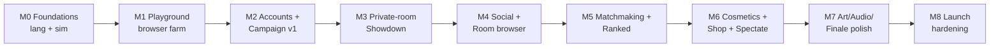

# Milestones

Each milestone has **exit criteria**. Don't start the next milestone until they're met. Sizes are for one focused developer working with an AI assistant: S ≈ 1 week, M ≈ 2–3 weeks, L ≈ 4–6 weeks.

## M0: Foundations (M)
**Goal:** The language and simulation exist and are provably deterministic. No UI.
- pnpm workspace, TS strict, ESLint (purity rules), Vitest, CI `ci.yml`
- `lang`: lexer, parser, checker, compiler, VM, diagnostics (core catalogue)
- `sim`: grid, tiles, 3 crops, actions/sensors, discrete-event scheduler, market, event log, state hash
- `content`: crops, stdlib costs, 3 bot programs
- `tools/run`: CLI `pnpm sprout run file.sprout --seed 42 --players bots/grower.sprout`
- Golden + determinism tests in Node and Playwright (3 engines)
- Balance harness v0

**Exit:** the starter program and 3 bots run. Golden hashes match across Node, Chromium, Firefox and WebKit. An 8-player showdown executes in under 100 ms.

## M1: Playground (M)
**Goal:** A single farm in the browser, fun to poke at. Local only, no accounts.
- Vite app, R3F scene, procedural voxel crops (4 stages), placeholder drone
- CodeMirror + Lezer Sprout mode, diagnostics, autocomplete, cost lens
- Worker-based run/pause/step/speed/reset, event-driven animation
- 3 hand-made contracts (Ch1) hard-coded
- Root `pnpm build` script (`pnpm -r build`: the web app and the asset-bake tools), run by `ci.yml` and later by Render

**Exit:** A non-programmer friend completes Ch1 contracts without help in 10 minutes. 60 fps on a mid laptop.

## M2: Accounts & Campaign v1 (L)
- Fastify server, Better Auth (Google, email OTP via Resend, email+password), pre-auth 13+ age gate on the landing screen, onboarding (handle, then versioned Terms/Privacy acceptance)
- Drizzle schema v1 on Neon, migrations, preview branches
- Campaign save/load, run receipts with server re-simulation, farm credits, skill tree v1 (Ch1–5 nodes)
- Chapters 1–5 content, lesson cards
- Deploy to Render (option A single service), `smoke.yml` and `release.yml` promotion (see [environments-and-ci](../06-infrastructure/environments-and-ci.md))
- Static privacy policy and terms pages (draft, LEG-02a); Google consent screen in Testing
- Nightly backups running (`backup.yml`)
- Uptime monitor and runbooks skeleton

**Exit:** A new user can sign up on a laptop or tablet, finish Ch1–5, and buy skill nodes. (Phone play of the campaign arrives with Blocks mode in M7.) Credits survive reloads and devices. A tampered receipt is rejected.

## M3: Private-room Showdown (L)
- WebSocket layer (tickets, heartbeat, clock sync, reconnect)
- Rooms: create/join by code, lobby, ready, phase machine, timers
- Coding phase with draft autosave, lock, official lockstep execution in a worker_thread
- Event-log streaming, finale v1 (functional, not pretty), results with code viewing and replay
- Rewards v1 (SRV-07): XP for custom rooms, match persistence + ledger write in one transaction. The placement-to-credit payout table is implemented but gated to matchmade modes (casual/ranked), which arrive in M5 (scoring-and-judging §Multiplayer rewards)

**Exit:** 4 people on 4 devices complete a showdown. A disconnect and reconnect mid-coding keeps their code. Replays reproduce exactly. Custom-room matches award XP only; no wallet credits are minted (multiplayer-modes Modes table).

## M4: Social & Room Browser (M)
- Handles search, friend requests, friends panel, presence, block
- Parties, invites, party → custom room
- Public custom rooms, live room browser with filters, share links `/r/CODE`
- Quick-chat and emotes

**Exit:** Two friends can find each other, party up and play a custom room without sharing a code out-of-band.

## M5: Matchmaking & Ranked (L)
- Casual queue (solo + party), bots fallback
- Ranked queue (solo, 4 FFA), ready check with accept UI, cooldowns
- Seasons: "Season 0" is the internal pre-season used only for M5 testing (no end-of-season rewards; its rank state is wiped at open launch in M8, when the first ranked season, "Season 1: Sowing", begins). RP rules, placements, shields, season-end modal, rank emblems, leaderboard
- Queue pill, match-found modal, notifications

**Exit:** With the 12 e2e seed accounts (`pnpm db:seed:e2e`), queues form matches within the window rules. Declines requeue the others at original priority. RP math matches the docs in unit tests: the table row sums (+19, +10, +1, −8, −17), five placement wins from Bronze III 0 ending at Silver III 25 RP, clamp-at-0 and the demotion warning, a shield after every promotion, and the soft-reset formula.

## M6: Cosmetics, Shop & Spectate (M)
- Cosmetics catalogue + Locker + equip, shown in lobby, finale and profile
- Shop (weekly rotation), purchase transactions
- Profile page, badges, awards, match history with Replay links (until then Replay is reached from Results only)
- Spectate live matches (finale and replay only, since code stays hidden until results)

## M7: Art, Audio & Finale Polish (L)
- Commissioned or hand-authored hero models, backdrops, farmer avatars
- Adaptive music, full SFX set
- Finale choreography v2 (money towers, podium, confetti), home farmhouse diorama
- Chapters 6–10, Blocks mode (tablets, and phone play of the campaign), accessibility pass

## M8: Launch Hardening (M)
- Load test: 500 concurrent sockets, 50 simultaneous showdowns on staging
- Observability, alert routing, status page, completed runbooks, `security.txt`, graceful drain deploys
- Backups verified: restore drill into staging completed, reconciliation clean
- Lawyer-reviewed privacy policy and terms, Google consent screen published, data export and deletion, moderation tools (reports queue)
- Closed beta, then open launch

## Explicitly after launch
Duel (1v1) queue · duo ranked · friends-only text chat · classroom mode · offline Free Farm earnings · Relay 2v2 · user-made challenges · monetisation decision.
